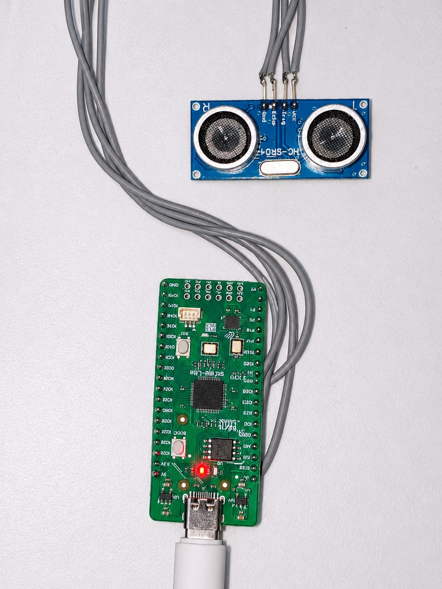
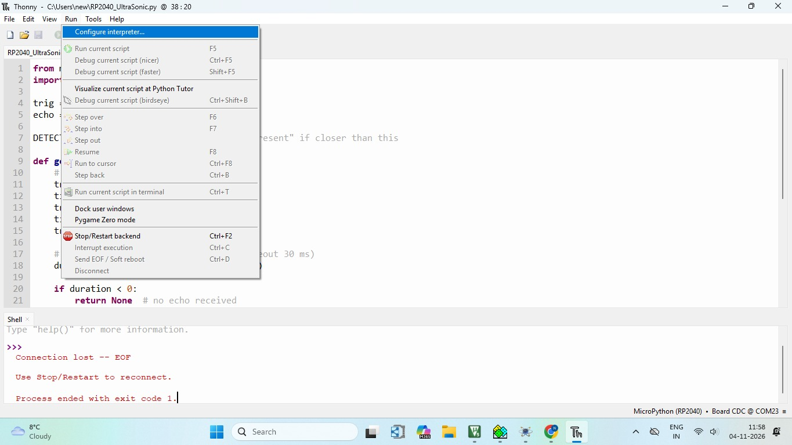
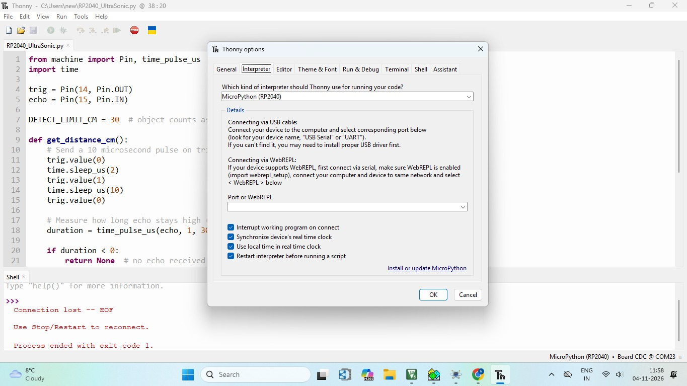
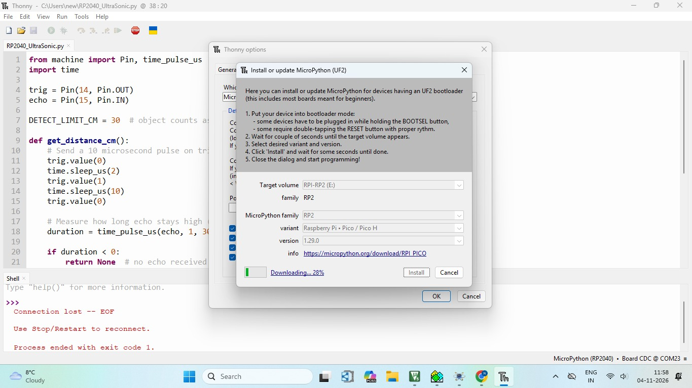
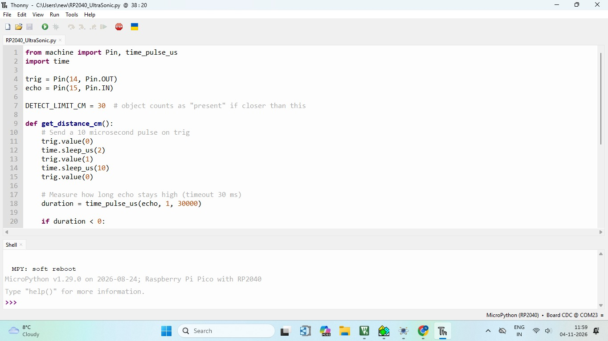
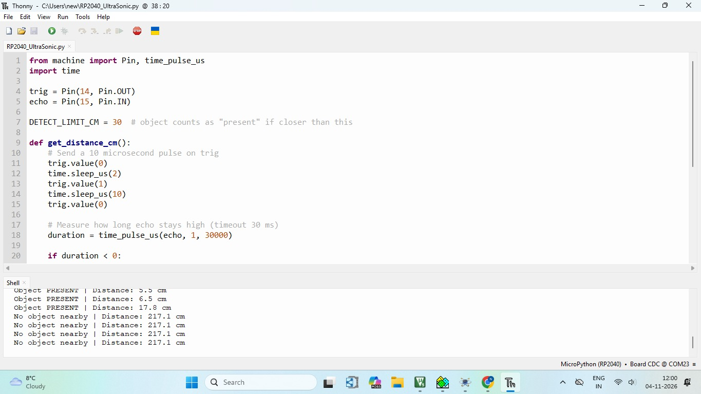

# RP2040 Ultrasonic Distance Measurement using HC-SR04 and MicroPython


## Project Overview

This project measures the distance of an object using an **HC-SR04 ultrasonic sensor** connected to an RP2040 board. The program is written in **MicroPython** and run from the **Thonny IDE**.

The board sends a trigger pulse to the sensor and measures how long the echo signal stays HIGH. This time is converted into distance in centimeters. If the object is closer than 30 cm, the Shell reports **Object PRESENT**, otherwise it reports **No object nearby**. A new reading is printed every 0.5 seconds.

## Key Features

- Distance measurement in centimeters using the HC-SR04 sensor
- Object presence detection with a 30 cm limit
- Echo timeout of 30 ms, with a "No echo" message if no echo is received
- New reading every 0.5 seconds
- Output viewed in the Thonny Shell
- Written in MicroPython with only the `machine` and `time` modules

## Hardware Required

| Component | Quantity |
|-----------|----------|
| RP2040 board | 1 |
| HC-SR04 ultrasonic sensor | 1 |
| Jumper wires | As needed |
| USB Type-C cable (data cable) | 1 |
| Computer with Thonny installed | 1 |

### Hardware Setup



## System Architecture

```
   RP2040 board
   IO14 (Trig) ──► HC-SR04 ──► sound pulse ──► object
   IO15 (Echo) ◄── HC-SR04 ◄── echo ◄──────────┘
        │
        ▼
   Measure echo time → distance (cm)
        │
        ▼
   Thonny Shell (USB)
```

## Pin Configuration

| Function | RP2040 Pin | HC-SR04 Pin | Mode |
|----------|------------|-------------|------|
| Trigger | IO14 | Trig | Output |
| Echo | IO15 | Echo | Input |

## Code

The project has a single source file:

```
RP2040-HCSR04-Distance/
├── RP2040_UltraSonic.py
├── Run_Configure_Interpreter.jpeg
├── Interpreter_Window.jpeg
├── Install_MicroPython.jpeg
├── Stop_SoftReboot.jpeg
├── Hardware_Setup.jpeg
├── Shell_window.jpeg
└── README.md
```

### RP2040_UltraSonic.py

```python
from machine import Pin, time_pulse_us
import time

trig = Pin(14, Pin.OUT)
echo = Pin(15, Pin.IN)

DETECT_LIMIT_CM = 30  # object counts as "present" if closer than this

def get_distance_cm():
    # Send a 10 microsecond pulse on trig
    trig.value(0)
    time.sleep_us(2)
    trig.value(1)
    time.sleep_us(10)
    trig.value(0)

    # Measure how long echo stays high (timeout 30 ms)
    duration = time_pulse_us(echo, 1, 30000)

    if duration < 0:
        return None  # no echo received

    # Sound speed: 0.0343 cm/us, divide by 2 for round trip
    return (duration * 0.0343) / 2

print("HC-SR04 distance sensor started")

while True:
    distance = get_distance_cm()

    if distance is None:
        print("No echo - check wiring")
    elif distance < DETECT_LIMIT_CM:
        print("Object PRESENT | Distance: {:.1f} cm".format(distance))
    else:
        print("No object nearby | Distance: {:.1f} cm".format(distance))

    time.sleep(0.5)
```

### Configurable Values

| Variable | Default | Description |
|----------|---------|-------------|
| `DETECT_LIMIT_CM` | 30 | Objects closer than this are reported as present |
| Echo timeout | 30000 µs | Maximum wait time for the echo signal |
| Reading interval | 0.5 s | Delay between two readings |

## Setup Process

MicroPython must be installed on the board before running this program. The steps are the same as in the "hi from RP2040" project.

### Step 1: Open Configure Interpreter

In Thonny, go to **Run → Configure interpreter**.



### Step 2: Select the Interpreter

In the **Interpreter** tab, select **MicroPython (RP2040)**. Then click **Install or update MicroPython**.



### Step 3: Select the MicroPython Variant

Put the board in bootloader mode as the Thonny dialog describes, wait for the target volume to appear, then select:

| Setting | Value |
|---------|-------|
| Target volume | RPI-RP2 |
| MicroPython family | RP2 |
| Variant | Raspberry Pi • Pico / Pico H |
| Version | 1.29.0 |

### Step 4: Install MicroPython

Click **Install** and wait until the copying reaches 100%. Then close the dialog.



### Step 5: Check the Connection

After installation, the Shell shows the MicroPython version and the `>>>` prompt, and the bottom right of Thonny shows **MicroPython (RP2040) • Board CDC**. The board is ready.



## Working

1. The trigger pin (IO14) is set LOW for 2 µs, HIGH for 10 µs, then LOW again. This makes the HC-SR04 send an ultrasonic pulse.
2. The echo pin (IO15) goes HIGH while the sensor waits for the reflected sound.
3. `time_pulse_us()` measures how long the echo pin stays HIGH, with a timeout of 30 ms.
4. The time is converted into distance:

```
Distance (cm) = (echo time in µs × 0.0343) / 2
```

The speed of sound is 0.0343 cm/µs, and the result is divided by 2 because the sound travels to the object and back.

5. The Shell shows the result:
   - Distance below 30 cm: `Object PRESENT`
   - Distance of 30 cm or more: `No object nearby`
   - No echo received: `No echo - check wiring`
6. The program waits 0.5 seconds and repeats.

```
Send pulse → Measure echo → Calculate distance → Print → Wait 0.5 s → repeat
```

## Output

The readings are shown in the Thonny Shell:

```
Object PRESENT | Distance: 6.5 cm
Object PRESENT | Distance: 17.8 cm
No object nearby | Distance: 217.1 cm
No object nearby | Distance: 217.1 cm
No object nearby | Distance: 217.1 cm
No object nearby | Distance: 217.1 cm
```

| Message | Meaning |
|---------|---------|
| Object PRESENT | An object is closer than 30 cm |
| No object nearby | No object closer than 30 cm |
| No echo - check wiring | No echo signal was received |



## How to Run

1. Install **Thonny** on your computer.
2. Connect the HC-SR04 sensor to the board: Trig to IO14 and Echo to IO15.
3. Connect the board to the computer with a USB data cable.
4. Install MicroPython using the Setup Process above, if it is not installed yet.
5. Open `RP2040_UltraSonic.py` in Thonny.
6. Click **Run**, or press **F5**.
7. Move an object in front of the sensor and watch the Shell.
8. Click **Stop** (or press **Ctrl+C**) to end the program.

## Important Notes

### No Echo Message

If the Shell shows `No echo - check wiring`, check the Trig and Echo connections, the sensor power and the common ground.

### Detection Limit

Change `DETECT_LIMIT_CM` in the code to set a different detection distance.

### USB Cable

Use a data-capable USB cable. Some cables only charge and the board will not appear on the computer.

## Technologies and Concepts

- RP2040
- MicroPython
- Thonny IDE
- HC-SR04 ultrasonic sensor
- Pulse width measurement with `time_pulse_us()`
- Time-of-flight distance calculation

## Future Improvements

- Show the distance on an LCD
- Add a buzzer or LED for object detection
- Average several readings for steadier values
- Log the distance values to a PC
